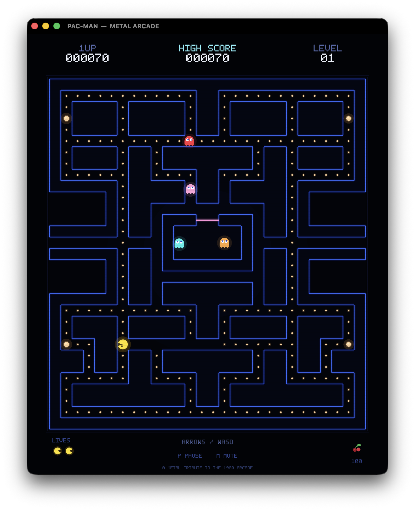

# PAC-MAN — Metal Arcade

A complete, native macOS Pac-Man tribute written from scratch in Swift, rendered entirely with Metal. There are no sprite sheets, no game engine, and no runtime-asset downloads: the maze, characters, fruit, pixel font, logo, app icon, and chiptune sound effects are all generated procedurally.

Canonical source: <https://github.com/dlcmh/pac-man-arcade-swift-macos>



## Play

From a fresh clone:

```bash
git clone https://github.com/dlcmh/pac-man-arcade-swift-macos.git
cd pac-man-arcade-swift-macos
make app
open dist/PAC-MAN.app
```

To produce a distributable disk image as well:

```bash
make dmg
# dist/PAC-MAN-1.0.dmg
```

Generated bundles under `dist/` are intentionally not committed. For development with Swift Package Manager:

```bash
make run
```

Requires macOS 13 or newer and a Mac with Metal support. The project builds with the Swift toolchain included in Xcode or the Command Line Tools.

## Controls

| Key | Action |
| --- | --- |
| Arrow keys / WASD | Move Pac-Man |
| Return / Space | Start game / play again |
| P | Pause / resume |
| M | Mute / unmute |
| Esc | Pause |
| ⌘N | New game |
| ⌘P / ⌘M | Pause / mute (menu shortcuts) |
| ⌃⌘F | Toggle full screen |

The window is resizable and maintains the arcade board's aspect ratio. Sound can be muted at any time; the setting is remembered.

## What is implemented

- The canonical **28 × 31 arcade maze**, with **244 pellets** (240 dots and 4 flashing power pellets).
- Smooth tile-based Pac-Man movement with buffered corner turns, instant reversal, and the two side tunnels.
- Four ghosts with distinct arcade personalities:
  - **Blinky** chases Pac-Man directly.
  - **Pinky** aims four tiles ahead, including the original up-target overflow quirk.
  - **Inky** uses the vector from Blinky through Pac-Man's two-tile lookahead.
  - **Clyde** chases when far away and peels off to his corner when close.
- Scatter/chase phase switching, frightened mode, ghost-house release timing, random frightened movement, eaten ghosts returning home as eyes, and a ghost-revival wait in the house.
- Dot and pellet scoring, ghost-combo scoring (200 → 400 → 800 → 1600), an extra life at 10,000, persistent high score, lives, level progression, and level-specific fruit.
- Death animation, ready screen, level-clear flashing, pause screen, attract screen, and game-over screen.
- A single-draw-call Metal renderer with 4× MSAA, neon maze walls, animated characters, CRT scanlines, and a custom 5×7 pixel font.
- Procedural chip-style sound effects generated at launch with AVAudioEngine.

## Project layout

```
Sources/PacManCore/        Pure Swift game simulation (no AppKit)
  Maze.swift               Canonical maze, pellets, tunnel & ghost-house routing
  Game.swift               Movement, ghost AI, scoring, phases, events
  Math.swift               Directions, vectors, deterministic RNG
Sources/PacManArcade/      macOS executable
  AppDelegate.swift        Window, application menu
  GameView.swift           MTKView, fixed-step loop, keyboard input, high score
  Renderer.swift           Scene composition and procedural art
  Canvas.swift             Immediate-mode triangle primitives
  PixelFont.swift          5×7 vector-pixel font
  MetalShaders.swift       Inline Metal shaders
  SoundEngine.swift        Procedurally synthesized sound effects
Checks/                    Dependency-free simulation checks
scripts/                   App bundle + icon generation
Resources/                 Info.plist and generated app icon
Docs/                      Screenshots, project-origin record, Q&A, Metal crash course
  QnA/                     Source-grounded answers to individual questions
  Refactoring/             Dated records of evaluated refactor proposals
AGENTS.md                  Operating instructions for coding agents
CONTRIBUTING.md            Contribution workflow and quality bar
GOVERNANCE.md              Decision-making, release, and IP policy
SECURITY.md                Vulnerability reporting and privacy posture
```

The simulation is deliberately independent of AppKit and Metal so it can be tested headlessly.

## Verification

```bash
make checks
```

The checks cover maze dimensions and pellet totals, reachability of every pellet, tunnel wrapping, the eyes' path home, state transitions, dot scoring, wall stops, buffered turns, pause behavior, ghost-house release, a 60-second movement soak test, an autopilot run that reaches a power pellet, ghost collision/death handling, and game over. The current baseline passes **21,646 checks**.

## New to Metal?

If you have never written a GPU API, the [Metal crash course](Docs/METAL_CRASH_COURSE.md) starts from "what is the GPU actually doing?" and walks through this renderer's shaders, vertex buffers, single draw call, blending, and MSAA using the actual source. It assumes no Metal or graphics knowledge and translates the concepts to familiar web ideas along the way.

## Questions and answers

[`Docs/QnA/`](Docs/QnA/README.md) collects source-grounded answers to individual questions about how the game works. The entries cover ghost targeting, BFS, the CPU/Metal split, attract mode, and the headless `PacManCore` architecture, and each one links to the files and symbols it describes.

## Refactoring

[`Docs/Refactoring/`](Docs/Refactoring/README.md) holds dated records of refactors that were proposed and evaluated, newest first, each with the evidence behind the decision so it does not have to be re-derived. The first entry weighs [deferring `check` failure messages with `@autoclosure`](Docs/Refactoring/check-failure-message-autoclosure.md) — including whether the optimization pays for itself when the messages are string literals.

## Project and governance

- [Project origin](Docs/PROJECT_ORIGIN.md) — the original commission, scope decisions, and delivery record
- [Contributing](CONTRIBUTING.md)
- [Governance](GOVERNANCE.md)
- [Security policy](SECURITY.md)
- [Agent instructions](AGENTS.md)

No open-source license has been selected for this repository; see the governance policy before reusing or redistributing any part of it.

## Notes

PAC-MAN is a trademark of Bandai Namco Entertainment Inc. This is a fan-made, non-commercial technical tribute and is not affiliated with or endorsed by Bandai Namco. All artwork, audio, and code in this repository are original procedural work. The level-256 kill screen from the arcade original is acknowledged as history but is not emulated.
